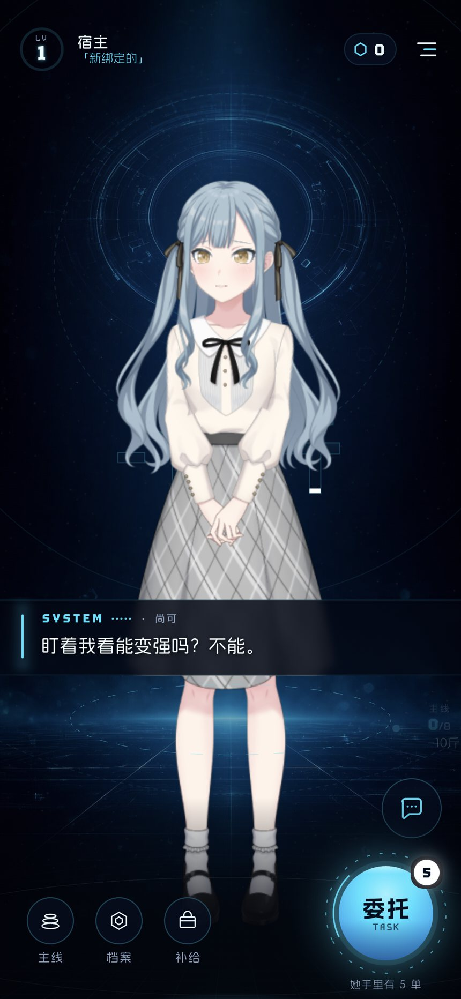
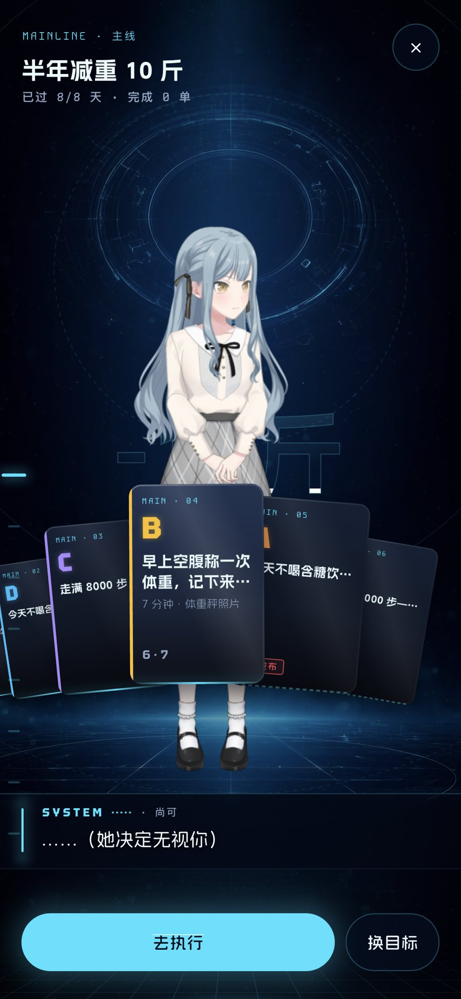
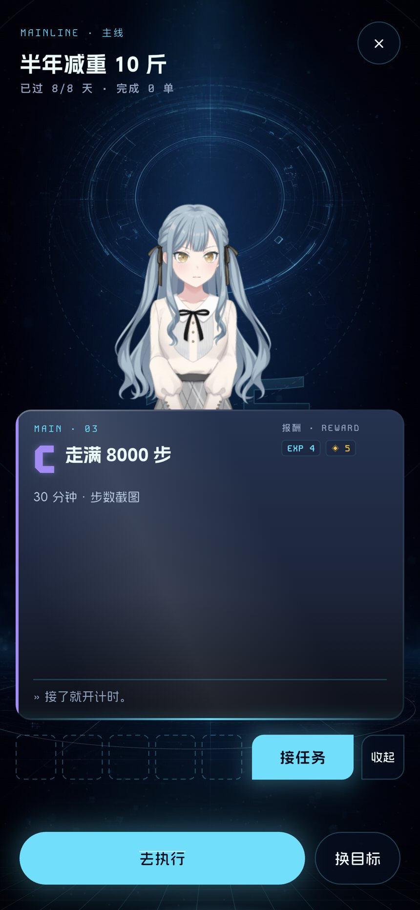

# 39 · 首页与主线 UI/UX 真机走查 + 组件级样式修改方案

> 状态：**施工稿 · 已落地（v15）** —— 走查结论已按 §6 的 P0/P1/P2 三批全部施工完毕；落地明细与降级项见 §10「施工记录」
> 走查日期：2026-10-17 · 施工日期：2026-10-17（同一日，4 个 Agent 并行 + Lead 集成）
> 真机：iPhone 15 Pro Max「TK」（iPhone16,2），iOS 27.0.1，430 × 932 pt @3x
> 构建：master `91200d6` + 临时 audit entrypoint（用完已删除），Xcode 27 profile 构建
> 走查方式：`devicectl` 安装/启动 + 临时入口注入 pointer 事件（唤醒 → 主线 → 牌屉）+ `devicectl capture screenshot` 截图；**未改产品代码、未覆盖宿主存档**
> 证据目录：`.verify/ui-audit-device/`（本机，gitignore）；本文引用的 4 张原图 + 4 张局部裁图已存到 `docs/assets/39-ui-audit/`
> 覆盖：大厅（首页）、主线牌扇、主线牌屉、换目标输入幕、开机屏
> 未覆盖：执行中态、已完成卡的开屉、空目标态、键盘弹出态、超长目标文案 —— 宿主存档是「主线 0/8、队列 5」，这些状态需要另一份 demo 档才能实拍；文中标 ○ 的部分是代码推定。

---

## 0 · 一页速览

**首页：视觉主角成立，但系统层几乎不存在。**
1. **目标进度不可见**：挂签 PlanTag 恒 `.18` 不透明度，且右边缘超出 430 屏宽被裁掉；真机上只剩一片几乎看不见的「主线 0/8 -10斤」贴在右腿外侧（图 05/06）。
2. **主 CTA 的状态机是假的**：Dock 的 `running` 写死 false，执行中也不显示计时；底注「换日还有 0 小时」是硬编码假读数；执行中从大厅点它仍会进派单板（二次接单老坑的入口之一）。
3. **HUD 压在她的浅色头发上**：没有顶部压暗，名字/称号直接叠在亮发上（图 01/05）；菜单命中区只有 34 × 34 且没有任何按下反馈。
4. **底部安全区与信息层级**：底注距屏底 8pt、CTA 与聊天圆钮在右侧竖排，主次靠大小区分但都「圆、亮、青」。

**主线：牌桌的骨架是对的，但「牌」还没有变成可端详的实物。**
1. **牌扇太满、侧牌被裁**：一屏 5~6 张，±2 位只剩一条边，标题被切；领位牌 132×196、标题 15pt 被 30pt 的档位字母抢了主句（图 02）。
2. **牌屉有一半是空的**：真机图里牌屉卡片 55% 面积是纯玻璃空板；下面 5 个虚线证据槽无标签无数据；同一屏出现【接任务】+【去执行】两个主 CTA（图 03/07）。
3. **状态与交互不成体系**：可接与执行中同一条亮青线（呼吸代码是死代码）；非「可接」的牌点下去只出声、不打开；开牌屉与接任务都放 `seal` 音效。
4. **进页没有「发牌」**：整页只是 400ms 线性淡入，牌桌入场在组件首次构建时就播完了；进度带 `t: 0` 冻住；执行药丸的 400ms 入场是死代码。
5. **刻度轨隐形**：真机只能看到左缘一根 3~6px 的小绿刻度；没有轨道、读数、窗口提示；点/拖都直接开牌屉，导航与检查混在一起。
6. **换目标取消藏在屏外**：CANCEL 是牌列最右一张，被裁掉一半（图 04/08）；输入幕没有常驻取消。

**一句话**：不需要重做风格。做 **2 个结构性修正**（主行动状态机、全态可点开）+ **4 组样式/动效精修**（顶部压暗与目标锚、牌扇尺度与状态、牌屉内容重排、统一转场与心跳），就能从「能用」到「愿意截屏」。

---

## 1 · 走查条件与证据说明

| 项 | 说明 |
|---|---|
| 真机 | iPhone 15 Pro Max / 430×932pt / iOS 27.0.1；竖屏；开发者模式已开 |
| 构建 | `flutter build ios --profile` + 临时 audit entrypoint；`devicectl install app` / `process launch` 启动 |
| 启动方式 | 为什么不用 `flutter run`：无线设备附着多次卡在设备发现阶段；改用 profile 包 + devicectl 启动，画面与 debug 一致 |
| 截图 | `xcrun devicectl device capture screenshot`（1290×2796） |
| 存档 | 走查使用宿主真实存档，**没有 seed demo 档**；状态为：宿主 LV1 / 金币 0 / 称号「新绑定的」/ 主线「半年减重 10 斤」0/8 完成 / 队列 5 单 |
| 动效 | devicectl 不支持录屏；动效结论 = 截图序列 + 代码时序核对。本文的动效数字均可直接落到 Flutter |
| 干扰 | 两张牌扇/换目标截图可能混入宿主手动触摸；「换目标输入幕」是走查中真实出现的状态，不是脚本打开。牌扇领位偏移若复现不稳，以 §4 的“待查”项处理 |
| 模拟器 | 同型号 iOS 模拟器上原生 Live2D 直接 `SIGBUS`（EXC_BAD_ACCESS），本轮已留崩溃报告；**真机是唯一可靠舞台** |

**图例**：✅ 真机截图确认 ｜ ◐ 代码/截图可确认 ｜ ○ 仅代码推定（本次没实拍）

---

## 2 · 真机看到什么

### 2.1 首页（图 01 / 05 / 06）

- **她的占比**：她几乎铺满整屏，脸在屏高约 10%~30%；这是对的——首页首先是一张角色卡，而不是仪表盘。
- **HUD**：LV 环、名字「宿主」、称号「新绑定的」直接压在她的浅灰蓝头发上；白字对比不足，称号的青字更弱。顶部没有任何压暗或玻璃承托。
- **挂签**：在右腿外侧，只有「主线 / 0 / 8 / -10斤」几块极淡的文字，右侧被屏幕裁断；截图里几乎要贴到聊天圆钮。
- **字幕带**：满宽玻璃带，17pt，压在她裙腰处；文字很好读，但整条带把她从中间切断。
- **底栏**：三颗侧键 + 104 的委托球；右侧上方还有 56 的聊天圆钮；最底下一行 10pt「她手里有 5 单」，离屏幕底边只有 8pt。
- **进度带**：在她膝盖处有一圈很淡的虚线椭圆；这是首页唯一与目标有关的画面信息，但读不出 0/8。

### 2.2 主线牌扇（图 02）

- **抬头**：kicker / 22pt 标题 / 11pt 读数 / 右上 ×；标题与读数都清楚，但读数是「已过 8/8 天 · 完成 0 单」——目标已到期且 0 完成，界面没有任何「到期了/下一步」的提示。
- **牌扇**：一屏 5~6 张，领位 132×196；领位牌上最大的是档位字母（30pt），任务名 15pt 反而第二；侧位标题被 96 的 stride 和缩放裁掉，右边缘只剩一条 3~10px 的卡边。
- **牌扇重心**：真机截图里领位牌视觉中心比屏幕中心左约 30pt（可能夹带宿主手势；待用单测钉住）。
- **刻度轨**：左缘只看到一根青色小刻度，没有轨道/读数；不知道能拖。
- **底部**：全宽亮青【去执行】+ ghost【换目标】；「去执行」在没有任何执行中任务时其实是打开派单板，很容易被理解成「执行这张牌」。
- **字幕**：底部「……（她决定无视你）」；位置在牌扇下缘与 CTA 之间，不挡牌，人格感好。

### 2.3 主线牌屉（图 03 / 07）

- **卡片**：宽 398、高约 318（430 真机；390 设计基准下为 358×282），从 45% 铺到约 86%；但内容只占顶部约 1/3 和底部批注，**中间约 55% 是空玻璃**。
- **内容**：kicker + 档位 C + 名称 + 「30 分钟 · 步数截图」+ 右上报酬（EXP 4 / ◈5）+ 底部「» 接了就开始计时。」；没有主图、没有证据、没有状态说明。
- **证据托盘**：5 个虚线空槽在卡片下面，无标签、无数据、无点击。
- **动作**：牌屉里【接任务】+【收起】；页面底部还有【去执行】+【换目标】。同一屏两个实心青 CTA，眼睛不知道先看哪个。
- **舞台**：牌屉直接压在角色上，没有压暗/聚焦；她的脸仍亮，但卡片与角色之间没有“前后景”关系。

### 2.4 换目标输入幕（图 04 / 08）

- 预设牌列在底部，领位「一个月早睡早起」；最右「TRY · 先问小祥」「CANCEL · 算了，不换」被屏幕裁掉一半以上。
- 屏上没有常驻取消；输入条右侧只有【确定】。键盘一旦弹起，整条牌列连布局都不占（代码 `ask_field.dart:275`），取消会彻底消失。
- 顶部没有“换目标会清空旧主线”的上下文提示；整屏只剩她的腿、牌列、输入条，层级偏空。

---

## 3 · 首页组件级修改

> 尺寸单位 pt（设计基准 430×932）；颜色用 `C.*` 令牌；动效数字可直接落 Flutter。
> 级别：P0 优先解决（下一批施工）；P1 决定“像不像游戏”；P2 打磨。

### 3.1 顶部 HUD

| 编号 | 组件 | 真机现状（证据） | 改成什么（精确值） | 动效 | 级别 |
|---|---|---|---|---|---|
| H-01 | 顶部承托 | 无压暗；名字/称号直接叠亮发（图 01/05） | 新增一层顶部渐变：高 **116**，`#020610` α **.78 → 0**；放在她之上、HUD 之下；不压脸 | 跟随 HUD 淡入；无循环 | P0 |
| H-02 | HUD 容器 | 高 74、内边距 16/18/16/0；名字列起点 72 | 左右边距统一 **20**；高 74 不变；名字起点约 **76**（20 + 46 + 10） | 进出 400ms kOut（已有，保留） | P1 |
| H-03 | LV 环 | 46×46；LV 7.5pt / 数字 19；环线 2.6；静态青辉光 | 尺寸 **48**；环线 **3**；LV **8.5** / 数字 **20**（Tektur 800）；静态辉光 blur 3→**2**、α .9→**.78**；升级时才全亮 | 跨级 780ms 编排保留（360/180/420） | P1 |
| H-04 | 名字 / 称号 | 14 / 11，无承托；称号青字在亮发上弱 | 名字 **15**（FangYuan 600，ls .5，C.ice）+ 阴影 `0 1 6 #000 .55`；称号 **11.5**（C.blue，ls .2）；两者单行省略 | 无 | P0（靠 H-01 解决对比） |
| H-05 | 金币胶囊 | 高 30、图标 13、数字 15；边框 .12；变化无动画 | 高 **32**；内边距 8/10→**9/11**；图标 **14**；数字 **16**（Tektur 700）；底 .55→**.62**；边框 **.16** | 数值变化 300ms count-up + 1.12→1 的 180ms 回弹 | P1 |
| H-06 | 菜单三横 | 命中 **34×34**；无按下反馈、无音效 | 视觉不变（18/12/15，高 1.6→**2**）；外扩透明命中到 **44×44**；按下 bars α **.72** | 按下 0ms；抬起 120ms；`tap` 音效 | P0 |
| H-07 | 连击 | `StreakPill(visible: false)`（宿主决定隐藏） | **本轮不动**；若以后接回，建议并进 LV 环右侧的 9.5pt 读数，不再做独立药丸 | — | — |

### 3.2 目标 / 进度

| 编号 | 组件 | 真机现状（证据） | 改成什么（精确值） | 动效 | 级别 |
|---|---|---|---|---|---|
| H-08 | 主线挂签 PlanTag | 恒 `.18`；右边缘超出 430 屏宽约 46pt，目标短字被裁；不跟随 1.4s 推镜（图 05/06） | **重做定位与排版**：宽 **112**、高 **48**，锚点 = `ProgressBand.point(cam, size) + (0,-18)`，左缘夹在 `[16, W-16-112]`；两行：① KodeMono 9.5「主线」+ Tektur 16「0/8」；② FangYuan 11.5 目标短字；底部 2px 进度条（done/total，青 α.6） | 常态 α **.78**；她说话时 **.55**；失败 **.35**；进度变化 600ms 1.06 脉冲；跟 `camObj` 逐帧走 | P0 |
| H-09 | 主线侧键（备选/并行） | 44 圆 + 11pt「主线」，与其他两键同权 | 在 H-08 基础上，给「主线」键加外圈 2px 进度弧 + 右上 9.5 Tektur `0/8`；标签保持「主线」 | 按压 scale .9 + 青光（已有）；换进度时弧走 400ms | P1（与 H-08 二选一为主，推荐都做但主次分明） |
| H-10 | 进度带 | `t: 0` 冻住；彗星/扫描不动；只有膝盖一圈虚线 | 接 20fps 相位 ticker（不要 60fps）：完成弧 α .62→**.75**；彗星头保持；扫描 0.2 保留但只在待机；**主线页隐藏**（见 M-12） | 完成时“收割”：旧值→新值 600ms easeOutCubic，彗星拖尾；结束 `seal` 轻震 + 挂签数字弹 1.06 | P1 |
| H-11 | 目标变化反馈 | 现在进度瞬变，没有“我变强了”的一拍 | 结算回大厅：进度带 600ms 涨、挂签数字 count 300ms、金币 count-up 300ms，三者同一起跑 | 一次轻震 + `count` 音；reduced-motion 只保留数字变化 | P1 |

### 3.3 台词、聊天与底栏

| 编号 | 组件 | 真机现状（证据） | 改成什么（精确值） | 动效 | 级别 |
|---|---|---|---|---|---|
| H-12 | 字幕玻璃带 | 17pt 正文、行高 1.58；宽满（20 边距）；无 maxLines，LLM 长句会压到聊天/挂签 | **maxLines 3** + ellipsis；超过 3 行时 17→**16.5**；边距 20；玻璃 blur 3.5 保留；上边线 .20→**.26**；左侧光条 2px 保留 | 进 240ms / 出 360ms（淡 + 8px 下移）；打字机 34ms/字保留；跳字保留 | P1 |
| H-13 | 对话圆钮 | 56、right 18 / bottom 150；无音效无震动；与 CTA 在右侧竖排 | **52**；right **20** / bottom **158**；底 .70→**.62**；边框 .12→**.16**；图标 44%；右上可选 4px 未读点 | 按下 .94；`tap` 音；无震动 | P2 |
| H-14 | 底栏侧键 | 44 圆 + 11pt 标签；间距 6；只有青描边 | 圆 44 保留；标签 **11.5**；间距 **8**；图标 21；按下青光 blur16 α.4 保留；补 `tap` 音 | 按下 0ms scale .9；抬起 120ms | P1（统一反馈） |
| H-15 | 委托 CTA | `running=false` 写死；执行中不显示计时；底注假读数；点它可能进派单板；呼吸 2.8s | **三态状态机**（见下表）；核心 88、球 104；呼吸 2.8→**2.4s**（与心跳同步）；徽标 24 → 数字 13；底注 **11pt**、bottom **14** | 状态切换 200ms 交叉 + 1.04 脉冲 180ms；执行中环呼吸；按压芯 .92 | P0 |
| H-16 | 执行中药丸 | 400ms 入场是死代码；主线上 top 80 与抬头读数打架 | Lobby 保留 top 80；动画改 **200ms 淡入 + 8px 下落**；闪烁 1.2s→**2.4s**；主线页改为**抬头里的一颗计时 chip**（不浮在屏上） | 进 200ms；出 160ms | P1 |
| H-17 | 安全区 | 底注距底 8pt；底栏 padding 26；无 SafeArea | 底栏底部 **34**；底注 bottom **14**；主线底排 bottom **34**；只对 top/bottom 用 `MediaQuery.padding`，不改 MuMu 观感 | — | P1 |
| H-18 | 环境层 | 天幕轨道 140/220/300s + 地面 31Hz + 颗粒；委托轨道 18s + 呼吸 2.8s | 保留；把“可感知循环”限为 **2 个**：她 + 2.4s 心跳（CTA 呼吸/进度带弧头/挂签光点同相位）；18s 轨道属不可感知层 | 心跳 2400ms；其余长周期 | P2 |

**H-15 主 CTA 三态（唯一主行动状态机）**

| 状态 | 视觉 | 点击 | 备注 |
|---|---|---|---|
| 待接（队列 > 0） | 青球 + 「委托 / TASK」+ 白色徽标 N | 开派单板 | 现状 |
| 执行中 | 玻璃芯 + **Tektur 22 计时** + 「执行中」9pt + 环 2.4s 呼吸；徽标隐藏 | **回执行面板** | 现在这个分支根本不可达；同时堵住“执行中再从大厅接单”的入口 |
| 今日已清 | 玻璃芯 + 「今日已清」15pt；不发光 | 她说一句，不动作 | 底注改真实换日倒计时（10 → 11pt，bottom 14） |

> 同一个状态机复用到主线底部【去执行】与牌屉底部动作：**无执行中=接任务/去派单板；执行中=继续执行**；不能再出现“主线上点去执行 → 又开派单板 → 可接第二单”。

---

## 4 · 主线组件级修改

### 4.1 抬头与关闭

| 编号 | 组件 | 真机现状（证据） | 改成什么（精确值） | 动效 | 级别 |
|---|---|---|---|---|---|
| M-01 | 标题 | 22 / ShuHei 400（实际只会渲染 Bold）；无 maxLines；maxWidth 280 | **24**（ShuHei 700）；maxLines **2** + ellipsis；maxWidth = `W - 40 - 56`（430 下约 334） | 进页 40ms 延迟、320ms 下落 10px | P1 |
| M-02 | 读数行 | 11pt；「已过 8/8 天 · 完成 0 单」在到期 + 0 完成时没有任何提示（图 02） | **12pt**；拆成两段：天数读数 + **状态 chip**（剩 N 天 / 已到期）；到期用 C.rS 线框 chip；执行中增加「执行中 12:04」chip | 状态切换 160ms | P1 |
| M-03 | 关闭 × | 44 圆；无按下反馈；位置 top 22 / right 20 | 视觉 **44**（命中 **48**）；按下 scale .94 + `tap` 音；右上与标题同轴 | 按下 0ms / 抬起 120ms | P1（务必补） |
| M-04 | 返回键 | 全库只有失败页有 PopScope（`main.dart:1099`）；Android 返回键直接退出 App | 加 `PopScope`：牌屉开 → 先关牌屉；否则回大厅；返回键与 × 同语义 | — | P0 |

### 4.2 牌扇

| 编号 | 组件 | 真机现状（证据） | 改成什么（精确值） | 动效 | 级别 |
|---|---|---|---|---|---|
| M-05 | 牌扇尺寸 | M 牌 132×196；一屏 5~6 张；±2 位被裁成一条边（图 02） | 领位牌 **148×220**；stride **104**；side scale **.84**；CardTable 高度 220+26+38+30=**314**（430 真机安全带约 382、390 基准 346，都放得下）；最多显示 **5 张**（领位 ±2） | 横滑弹簧 k120/ζ.9 保留 | P1 |
| M-06 | 领位 | 只有黑色落影；没有“这一张被抽出来”的光 | 领位增加青色外辉 **α .45 / blur 22**；黑色落影保留（0xB3050812 → 0xB3050812）；领位纵向提升 dy0 -6→**-12** | 换领位时外辉 200ms 淡入 | P1 |
| M-07 | 侧位摘要 | 侧位标题被压住 + 裁字；±2 位只剩边 | 相邻位只留：①角标、②档位、④单行标题 16pt（×.84≈13.4，达标）、⑨状态线；**隐藏** kicker/规则行/报酬；±2 位只留档位 + 状态线，不画文字 | 无 | P1 |
| M-08 | 卡面排版 | 档位 30pt / 800 + 14 辉光，压过 15pt 标题；标题主句弱 | 档位 **26pt / 800**、辉光 blur 14→**10** α .45；标题 **17pt**；kicker 9.5；规则行 **11.5**；报酬 13；印章 10 | — | P1 |
| M-09 | 状态线 | open 与 active 完全同款；`dutyBreathing` 是死代码；done 金线 / sealed 虚线 / abandoned 灰（图 02/03） | 五态形状 + 颜色双编码：**可接**亮青实线；**执行中**亮青 + **12px 光包沿 2px 线 1.6s 走** + 牌角 11pt 计时；**已完成**金线 + 实心印；**待发布**暗青虚线 + 线框印；**已放弃**灰线 + 整张压暗 .55 | active 光包 1.6s 循环；reduced-motion 静态亮线 + 计时 | P1 |
| M-10 | 点击语义 | 只有“可接”的领位能打开；其余状态点下去只有一点声音（图 02/03） | **点侧位=送位；点领位=打开牌屉（全五态）**；接任务只从牌屉里的按钮或按住手势发生；看详情 `tap/choose`，接单才 `seal` | 开屉 420ms；接单 280ms 压印 | P0 |
| M-11 | 牌扇重心 | 真机截图领位视觉中心左偏约 30pt（疑似夹带宿主手势；待复现） | 先补一条 widget test：`leadCardCenter.dx == W/2 ± 1`；若复现则查 RailShell 静止 `dx` 是否被“送位补偿”污染 | — | P1（待查） |

### 4.3 刻度轨

| 编号 | 组件 | 真机现状（证据） | 改成什么（精确值） | 动效 | 级别 |
|---|---|---|---|---|---|
| M-12 | 轨道本体 | 左缘只有一根 3~6px 青刻度，几乎不可见（图 02） | 轨道 x=**10**、宽 1px α .18；上下端帽 6px α .35；当前牌扇窗口用 3px 亮带标出；脚下菱形头 7px；最多 40 格 | 进度/窗口变化 160ms | P1 |
| M-13 | 交互 | 点/拖都直接开牌屉（`onTapDown` 立即跳转），拖拽分支不可达；擦洗说明名存实亡 | **拖动=移动牌扇领位；点=跳到那一段并移动领位；打开牌屉只由点牌触发**。拖动时右侧显示 `03/21`（Tektur 12，深色 chip）；松手 400ms 后淡出 | 每过一格 `rung` + choose；chip 淡出 400ms | P1 |
| M-14 | 脚下语义 | `active` 只由 firstOpenIndex + 拖拽决定；乱序完成不体现 | 轨道“脚下”改为**当前领位**；已完成段按 doneCount 着色；firstOpen 只作为初始领位 | — | P1 |

### 4.4 牌屉

| 编号 | 组件 | 真机现状（证据） | 改成什么（精确值） | 动效 | 级别 |
|---|---|---|---|---|---|
| M-15 | 牌屉卡片 | 398×318（430 真机；390 基准 358×282），55% 是空玻璃（图 03/07） | 重排为**三段式单卡**（宽 W-32，高约 **250**）：① 头部（kicker/档位 34/名称 19/规则行 12.5 + 右侧报酬 chip）；② **证据带**（5 槽 + 10pt 标签「证据 · 最多 5 张」）；③ 底部（她的批注 + 状态线）。空余用 ⑥/⑦/③ 补，**不允许整片空板** | 见 M-18 | P0（视觉最大缺陷） |
| M-16 | 证据托盘 | 5 个空虚线槽，无标签、无数据、无点击（图 03/07） | 移入卡片内；按状态给内容：可接=5 个虚线槽 + 「接单后可传证据」；执行中=真实证据缩略图 + 数量 + 添加；已完成=只读缩略图 + 「N 份」；待发布=锁形占位 | 槽位 24ms 错峰淡入 | P1 |
| M-17 | 动作区 | 牌屉【接任务】104×46 +【收起】44×46；页面底部还有【去执行】【换目标】（图 03/07） | 抽屉内主 CTA **124×48 切角 12**；【收起】48×48 ghost；**抽屉打开时隐藏页面底部两颗**（淡出 200ms）；状态动作：可接=接任务 / 执行中=继续执行 / 已完成=只读 / 待发布=现在派给我 / 已放弃=只读 | 按下 .96；接单 280ms 压印 + `seal` | P0 |
| M-18 | 开/关 | 牌屉从 44px 下方 420ms 上升；牌扇瞬间消失；关/换牌无退场 | **领位牌 Rect → 牌屉 Rect 的 420ms morph**（过冲 ≤1.06），透明度 200ms；关闭 260ms 反向；同时舞台压暗 **α .22 / 200ms**（脸保持亮） | 开 420ms；关 260ms；scrim 200ms | P1 |
| M-19 | 手势 | 只能点【收起】；无下拉关闭 | 牌屉支持**下拉关闭**（跟手 <120px 回弹；>120px 或速度 >600 关闭）；× 与返回键同语义 | 回弹 320ms；关闭 260ms | P2 |

### 4.5 底部与空态

| 编号 | 组件 | 真机现状（证据） | 改成什么（精确值） | 动效 | 级别 |
|---|---|---|---|---|---|
| M-20 | 主 CTA | 全宽 54 药丸【去执行】+ 自动宽【换目标】；无执行中时去执行=开派单板，语义误导 | 统一为 **cut-corner 14 / 高 56**；文案随状态：**接任务 / 继续执行 / 去委托板**；ghost 换目标 56；两者间距 10；底边 **34**；按下 .96 + `tap` | 状态切换 160ms；按下 0ms | P0（语义） |
| M-21 | 队列空 | 【去执行】整颗消失，【换目标】从右端跳到左端（代码推算；本次未实拍） | Row 保留主 CTA 占位（`Visibility(maintainSize)`）或用 `Spacer` 固定 ghost 在右；空态给一句“今日已清” | 160ms | P2 |
| M-22 | 空计划 | 只有一行 13pt「还没有计划。说一句你想变成什么样。」；底部按钮仍写「换目标」 | 文案改 **「立目标」** 且升为主 CTA；空态主体 14pt + 一个 48 高的主按钮；不再依赖右下角 | 进页 240ms | P2 |
| M-23 | 全部完成 | 没有任何“目标达成”状态（代码推算） | 进度带满环 + 金色压印「兑现」+ 她一句 + 【立新目标】；目标状态写进抬头 chip | 600ms 满环 + `seal` | P2 |
| M-24 | 换目标输入幕 | CANCEL 在牌列最右、被裁一半；无顶部上下文；键盘弹起牌列消失（图 04/08） | 输入幕左上常驻 **44 圆取消**；顶部加 11pt 上下文行「换目标 · 旧主线会清空」；CANCEL 从牌列移除；输入条 54；键盘只抬输入条 | 进 240ms kOut；取消与确认 `tap/choose` | P1 |

---

## 5 · 跨页动效系统

### 5.1 令牌（先加进 `design/tokens.dart`，再改组件）

| 层 | 用途 | 时长 | 曲线 |
|---|---|---|---|
| Touch | 按下 | 0ms（抬起 120ms） | 无 / kOut |
| Respond | 状态切换、小反馈 | **120–160ms** | kOut |
| Scene | 页面 / 场景 | **320ms**（内容）/ **520ms**（相机+chrome） | kOut / easeInOutCubic |
| Payoff | 接单、结算、升级、进度收割 | 780 / 600 / 280 / 200ms | 物理弹簧 / 分段 |

- 物理弹簧：牌桌 **k=120 / ζ=.9**；相机 **k=70 / ζ=.95**；过冲 ≤1.08。
- 系统心跳：**2400ms**，只驱动 CTA 呼吸、进度带弧头、挂签光点；同屏最多 **2 个**可感知循环（她 + 心跳），其余 ≥18s 的归环境层。
- 进/退：**内容先走、chrome 后回**；退场 = 进场的 **60%**；任何点击 0ms 响应。

### 5.2 首页 ↔ 主线（≤800ms）

| 时间 | 动作 |
|---|---|
| 0ms | HUD 上滑 220ms、Dock 下沉 260ms；相机 480ms easeInOutCubic 推到 full |
| 40ms | 抬头下落 10px / 320ms |
| 120ms | 牌扇逐张“发”出：每张 200ms、stagger 36ms，初始 scale .94 / 外倾 ∓4° |
| 200ms | 刻度轨 scaleY 0→1，260ms |
| 320ms | 底部两键上浮 16px / 240ms |
| 480ms | 字幕开始打字 |

- 退场反向，总长 **300ms**：内容 220ms 先走，chrome 320ms 回来；相机 480ms。
- 首页挂签 → 主线的连续性：挂签先淡出 200ms，再让牌扇从挂签方向展开（可选；至少不要“挂签还在、牌已铺开”）。

### 5.3 关键节拍

| 时刻 | 建议 |
|---|---|
| 开牌屉 | 领位牌 Rect→牌屉 420ms morph + scrim 200ms + 证据槽 24ms 错峰；关 260ms |
| 接任务 | 按下 .96 → 280ms 压印（scale 1.02 + 局部白闪 16%）→ 卡收成光痕飞向顶部计时 chip → 360ms 进执行面板 |
| 进度收割 | 600ms 弧增长 + 彗星；结束 `seal` 轻震 + 挂签/金币数字 300ms；reduced-motion 只留数字 |
| 换目标 | 主线内容 200ms 退 → 输入幕 240ms 进；取消/确定都 0ms 响应 |
| 环境心跳 | 2400ms 正弦，幅度小到“像呼吸不像闪” |

### 5.4 音效 / 震动语义（现状不统一，必须收口）

| 动作 | 音效 | 震动 |
|---|---|---|
| 侧键 / 菜单 / 聊天 / 关闭 / 收起 | `tap` | 无 |
| 看牌（开屉） | `tap`（现在错用 `seal`） | choose（轻） |
| 换领位 | `rung`（按格变调） | choose |
| 接任务 / 提交 | `seal` | seal |
| 页面转场 | 软 whoosh（新增） | 极轻一次 |
| 进度收割 / 升级 | `count` / `levelup` | 对应波形 |

### 5.5 reduced-motion / 性能

- 现在只有牌桌、滑轨、牌屉、ask 层读 `disableAnimations`；`FlashLayer` / `ShakeLayer` 的 `reduceMotion` 形参在调用点从不传（`main.dart:1108 / 1536`）。补：亮帧减半、震屏不抖、转场改 120–160ms 交叉淡化、进度带只留静态。
- 性能：`VoiceBars` 的 ticker 目前常驻 60fps（只在 `enabled=false` 停）；`BgLayer` 用 10Hz/31Hz 整层 `setState`；牌屉 420ms 的 `Opacity` 对整张玻璃卡做 saveLayer。本轮新增动画一律走 **15–20fps 的 painter ticker** 或 `Transform`/`Opacity`，不新增全屏 saveLayer。

---

### 5.6 无障碍与触控核对（桌面检查清单）

| 项 | 本次真机结论 / 改法 |
|---|---|
| 对比度 | HUD 名字/称号压在浅色头发上 → 先加 H-01 顶部压暗；正文/按钮目标 ≥ 4.5:1；9.5–11pt 的 mono 微标只作装饰，不承载唯一信息 |
| 触控面积 | 所有可点区域 ≥ 44×44：菜单 34→**44 命中**；× 视觉 44 / 命中 **48**；换目标取消常驻 **44**；牌桌按钮已达标 |
| 纯图标按钮 | 对话圆钮、菜单目前是无文字图标 → 补 `Semantics(label: ...)` / tooltip（对话圆钮「找她说」、菜单「系统设置」） |
| 状态表达 | 五种委托状态不能只靠颜色：保留状态线 + 形状 + 印章（M-09）；执行中额外给计时数字，颜色弱视也能读 |
| 字号 | 正文 ≥ **13**；按钮 **15**；功能标签 ≥ **10.5**；侧位标题按“×.84 后 ≥ 13”反推 base 16；不再出现 6.9px 的裁字 |
| 动效降级 | 补 `FlashLayer/ShakeLayer` 的 reduce 传参；转场改 120–160ms 交叉淡化；进度带/光包只留静态 |
| 返回行为 | 牌屉 → 主线 → 大厅逐级返回；Android 返回键不再退出 App（M-04） |
| 安全区 | 底栏/底排底边 ≥ **34**；底注 bottom ≥ **14**；顶部 HUD 与岛/状态栏用 `MediaQuery.padding` 兜底 |

---

## 6 · 施工顺序

| 批次 | 内容 | 文件面（预估） | 预期 |
|---|---|---|---|
| **P0 · 结构性修正（约 1 天）** | 主行动状态机 + 执行中守卫（首页 CTA / 主线去执行 / 牌屉动作）；PlanTag 定位/透明度/跟随 cam；HUD 顶部压暗 + 菜单 44 命中；主线全态可点开 + 返回键；牌屉去空板 + 去掉重复主 CTA；**领位牌居中单测** | `dock.dart`、`main.dart`、`plan_tag.dart`、`hud.dart`、`main_view.dart`、`card_table.dart`、`card_skins.dart` | 玩家不再点空、不再误接第二单、目标一眼可见 |
| **P1 · 手感与层级（约 1.5 天）** | 主线进/出编排；牌屉 morph + 状态化证据；刻度轨可视化与“导航/检查”分离；领位牌 148×220 + 侧位摘要 + 状态语言；系统心跳 + 进度收割 + 药丸修复；换目标常驻取消 | `main_view.dart`、`card_skins.dart`、`card_table.dart`、`progress_band.dart`、`main.dart`、`ask_field.dart`、`exec_pill.dart` | 从“能用”到“愿意截屏” |
| **P2 · 打磨（约 1 天）** | 空态/完成态；CTA 形态统一；安全区；描边/发光/字号收敛；reduced-motion + 性能；聊天钮/底注降噪 | `tokens.dart`、`line_layer.dart`、`voice_bars.dart`、`bg_layer.dart`、`fx_layer.dart` | 一致性与稳定性 |

**验收（不写额外自动化探针，按宿主真实手感）**
1. 冷启动 → 唤醒 → 大厅：3 秒内能指出“主线 0/8”，能看出「委托」是唯一主行动。
2. 执行中收起 → 回大厅：CTA 变计时且点它回执行面板；再点委托**不能**进派单板。
3. 大厅 → 主线：抬头/牌扇/刻度轨有先后，不是整页淡入；点任一状态的牌都能开屉。
4. 牌屉：无大块空板、证据槽有标签/有状态、只有一颗主 CTA；接任务后卡有压印并被计时 chip 接管。
5. 返回键：牌屉 → 主线 → 大厅，逐级返回，不退出 App。
6. 结算回大厅：进度带涨、挂签/金币数字动，不是一个瞬变。
7. 每批 `flutter analyze` 0 issue；只跑与改动直接相关的既有测试（含新增的 3 条：领位居中、全态开屉、CTA 三态）。

---

## 7 · 本次未覆盖 / 风险

| 项 | 说明 |
|---|---|
| 执行中态 | 宿主存档没有执行中单；CTA 执行态、牌屉计时、主线上执行 chip 均未实拍（○） |
| 已完成 / 待发布牌屉 | 走查只打开了“可接”牌；五态的只读内容需另一份 demo 档 |
| 空目标 / 全部完成 | 未构造；对应文案与仪式是方案稿 |
| 长文案 / 键盘 | 未实拍；maxLines 与安全区是代码推算 |
| 动效 | 只有截图序列，没有录屏；所有时长/曲线以代码为准，手感需宿主真机二次确认 |
| 截图干扰 | 牌扇/换目标两张截图可能混入宿主触摸；若与后续实现不一致，以实测为准 |
| 字体 | `ShuHei` 只有 Bold 一个静态字重，代码里请求 `wght:400` 实际仍是 Bold；标题方案按 Bold 设计，不再假装有细体 |

---

## 8 · 附：截图索引

| 文件 | 内容 |
|---|---|
| `docs/assets/39-ui-audit/01-lobby.jpg` | 首页真机（430×932） |
| `docs/assets/39-ui-audit/02-mainline-fan.jpg` | 主线牌扇 |
| `docs/assets/39-ui-audit/03-mainline-drawer.jpg` | 主线牌屉 |
| `docs/assets/39-ui-audit/04-goal-change.jpg` | 换目标输入幕 |
| `docs/assets/39-ui-audit/05-lobby-hud.jpg` | HUD 局部（名字压在亮发上） |
| `docs/assets/39-ui-audit/06-plan-tag.jpg` | 挂签局部（右侧被裁、近不可见） |
| `docs/assets/39-ui-audit/07-drawer-detail.jpg` | 牌屉局部（空板 + 证据槽 + 双 CTA） |
| `docs/assets/39-ui-audit/08-goal-change-rail.jpg` | 换目标牌列局部（CANCEL 被裁） |

原始未压缩截图：`.verify/ui-audit-device/`（本机保留，不入库）。

---

## 9 · 不做的事（这次别顺手“优化”）

- 不动 **45%~86% 安全带**：脸永远是第一优先级。
- 不重写 **CardTable 的连续几何/档位咬合/落定压印**：它是全 App 手感最好的部分。
- 不加新的稀有度色用法、不加 emoji、不加第三种青、不把正文压到 13pt 以下。
- 不为了“信息量”把她压小；首页的主语永远是她。
- 不把连击 pill 接回来（宿主 2026-10-11 已决定隐藏）。
---

## 10 · 施工记录（2026-10-17 · v15）

**验收**：`flutter analyze` → 0 issue；`cd app && flutter test` → **702 条全绿**（施工前基线 657 条，新增 45 条，零回归）。

### 10.1 批次 → 文件 → 关键数值

| 批次 | 内容 | 文件 | 关键数值（均已落地） |
|---|---|---|---|
| **P0-A** 首页 | H-01 顶部压暗 | `hud.dart` | 高 116 · `#020610` α .78→0 · 在 HUD 内部同一淡入相位 |
| | H-02…H-06 HUD 重排 | `hud.dart` | 边距 20 · LV 环 48/线 3/LV 8.5/数字 20/辉光 2@.78 · 名字 15 + 投影 · 称号 11.5 · 金币 32/图标 14/数字 16/α.62/边.16 + 300ms count-up · 菜单 visual 34 命中 **44** + `tap` + Semantics |
| | H-08 PlanTag 重做 | `plan_tag.dart` + `main.dart` | **112×48** · 锚点 `ProgressBand.point + (0,-18)` · 左缘夹 `[16, W-16-112]` · 三档 .78/.55/.35（取代恒 .18）· **camObj 逐帧跟手** · 2px 进度条 · 600ms 1.06 脉冲 · 数字 300ms count-up |
| | H-09 主线键弧 | `dock.dart` | 外圈 2px 进度弧 + 右上 9.5 Tektur `0/8` · 换进度 400ms |
| | H-13/H-14 底栏 | `chat_bar.dart` / `dock.dart` | 聊天钮 **52** / right 20 / bottom 158 + `tap` + Semantics · 侧键标签 11.5 · 间距 8 |
| | H-15 主 CTA 三态 | `dock.dart` + `main.dart` | **真状态机**（原 `running` 写死 false）· 执行中 Tektur 22 计时 + 环 2.4s 呼吸 + 徽标隐藏 · 今日已清不发光 · 底注 11pt/bottom 14 · **真实换日倒计时**（`dockRollCap` 纯函数）· 执行中点它**回执行面板**（堵二次接单） |
| **P0-B** 主线 | M-10 全态可点开 | `card_table.dart` + `main_view.dart` | 新增可选 `tapLeadAlways`（默认 false，其余四场景零改动）· 点侧位=送位 / 点领位=开屉（**全五态**）· 看详情 `tap`+choose / 接单才 `seal` |
| | M-04 返回键逐级 | `main.dart` | 单颗 `PopScope` + `_popScopeTarget()`，优先级 **失败页 > 牌屉 > 主线 > 默认** |
| | M-15/M-16 牌屉重排 | `card_skins.dart` + `main_view.dart` | 三段式单卡（头部/证据带/批注+状态线）· 高 ≈250 · 5 证据槽移入卡内 + 10pt 标签 · 空余由报酬/代价/维度补·**无整片空板** |
| | M-17 单一主 CTA | `main_view.dart` | 抽屉内 **124×48 切角 12** + 收起 48×48 · **抽屉打开时页面底部两颗淡出 200ms**（同一屏不再有两颗实心青） |
| | M-01/M-02/M-03/M-18/M-20…M-22 | `main_view.dart` | 标题 24/maxLines 2/maxW `W-84` · 读数 12pt + 状态 chip（剩 N 天/已到期/执行中 12:04）· × 按下 .94 + tap · 开 420/关 260/scrim 200 · 底 CTA cut-corner 14/h 56/底边 34 + 文案随状态 |
| **P1-C** 主线手感 | M-05 牌扇尺度 | `card_skins.dart` | 领位 **148×220** · stride **104** · side scale **.84** · 窗口 **5** 张 · CardTable 高 314 |
| | M-06/M-07/M-08 | `card_skins.dart` | 领位外辉 α.45/blur 22 · dy0 −12 · 侧位只留角标/档位/单行标题/状态线（±2 位不画字）· 档位 26/800·辉光 10 · 标题 17 · 规则行 11.5 |
| | M-09 五态双编码 | `card_skins.dart` | 可接＝亮青实线 · 执行中＝亮青 + **12px 光包 1.6s 循环**（15fps ticker）+ 牌角 11pt 计时 · 已完成＝金线+实心印 · 待发布＝暗青虚线+线框印 · 已放弃＝灰线+整张 .55 |
| | M-12/M-13/M-14 刻度轨 | `main_view.dart` | 轨道 x=10/宽 1px α.18 · 端帽 6px α.35 · 窗口 3px 亮带 · 脚下菱形 7px · **拖动=移领位 / 点=跳段 / 开屉只由点牌** · 拖动时 `03/21` chip（松手 400ms 淡出）· 脚下=当前领位 |
| | §5.2 进页编排 | `main_view.dart` | 抬头 40ms↓10px/320ms · 牌扇 120ms 起逐张 200ms/stagger 36ms/初始 .94/∓4° · 刻度轨 200ms scaleY 0→1/260ms · 底键 320ms↑16px/240ms · 总 ≤760ms |
| | H-10/H-11 进度带 | `main.dart` / `progress_band.dart` | 接 **20fps** 相位（原 t 冻 0）· 完成弧 α .62→**.75** · 主线页隐藏 · 结算回大厅 600ms 收割 + `count` + 挂签数字/金币同起跑 |
| **P1-D** 换目标/字幕 | M-24 常驻取消 | `ask_field.dart` + `main.dart` | 牌列**删除** CANCEL 整条链路 · 输入幕左上 **44 圆常驻取消** + 11pt「换目标 · 旧主线会清空」· 进 240ms kOut · 键盘弹起取消仍在 |
| | H-16 执行药丸 | `exec_pill.dart` | 删掉 `begin==end` 的**死 Tween** → AnimationController 边沿驱动 · 进 200ms 淡入+8px 下落 / 出 160ms · 闪烁 1.2→**2.4s** · 主线页不再浮（让位抬头 chip） |
| | H-12 字幕 | `line_layer.dart` | **maxLines 3 + ellipsis** · >57 字整句判 16.5（打字途中不跳字号）· 上边线 .20→**.26** · 进 240 / 出 360ms |
| | H-17 安全区 | `ask_field.dart`/`dock.dart`/`main.dart` | 全部改 `math.max(34, padding.bottom)` **下限**语义（不叠加）· 底栏底部 26→**34** · 底注 bottom 14 · 字幕 `bottomFloor` 兜底 |
| **P2-E** 打磨 | §5.5 reduced-motion | `main.dart`/`line_layer.dart`/`main_view.dart` | `ShakeLayer`/`FlashLayer` 的 `reduceMotion` **终于接上线**（原形参从不传）· 主线淡入 400→140ms · 牌屉 reduce 走 140ms 淡化 · 波形条退回静态 |
| | §5.5 性能 | `voice_bars.dart`/`bg_layer.dart` | VoiceBars 60fps 常驻 → **说话时才跑**（20Hz 无帧探针等下一个字）· BgLayer 轨道 10Hz/地面 31Hz **不再整层 setState**（`ValueNotifier` + painter `repaint:`）· 频率真源一个数没改 |
| | M-23 全部完成 | `main_view.dart` | 新增 `allDone` + `MainCtaAction.renew` · 暗轨+亮弧 **600ms** 满环 → **280ms** 金色压印「**兑现**」→ 她一句 → 【立新目标】· 抬头 chip「已兑现」· `seal` |
| | M-21/M-22 空态 | `main_view.dart` | 队列空主 CTA 占位常驻（ghost 不左右跳）· 空计划主体 14pt + 48 高通栏【立目标】· 240ms 进页 |
| | §5.4 音效核对 | 多处 | 看牌 `tap`+choose / 换领位 `rung` / 接任务·提交 `seal` / 收割 `count` / 升级 `levelup` / 立新目标 `seal` · **未新增音频资产** |

### 10.2 令牌落地

`app/lib/design/tokens.dart` 新增 **`Motion`** 类（§5.1 的四层 + 弹簧 + 心跳），并把 `kInOut` 补上：
`touchMs 0` / `releaseMs 120` / `respondMs 140` / `sceneContentMs 320` / `sceneChromeMs 520` / `harvestMs 600` / `stampMs 280` / `levelUpMs 780` / **`heartMs 2400`** / `drawerOpenMs 420` / `drawerCloseMs 260` / `scrimMs 200` / `cardTableK 120 ζ.9` / `cameraK 70 ζ.95` / `maxOvershoot 1.08` / `exitRatio .6` / `maxLooping 2`。
后续改动画先在这个类里找档位 —— 组件里不再写裸时长字面量。

### 10.3 降级项（**如实记录，未做就是未做**）

| # | 项 | 原因 / 现状 | 建议 |
|---|---|---|---|
| 1 | **M-19 牌屉下拉关闭** | 走查未覆盖该手势（§7 风险表），需跟手弹簧 + BoxConstraints 联动，不宜在收尾批顺手加；已删死的 `_drag` 字段并留注释 | 另开一批 |
| 2 | **§5.4 页面转场「软 whoosh」** | `Sfx.table` 已烘焙 84 件里没有 whoosh；任务纪律「不许伪造音频」 | 单独烘一个转场音再接线，或明确「转场不出声」 |
| 3 | **三处静音关闭点** | `sheet.close`（设置面板 ×）、`chat_panel` 的 `chat.close` 与点幕、`table_overlay` 点幕 —— 仍静音；`chat.close` 命中仅 36×36（<44） | 小任务批量补 `tap` + 扩命中 |
| 4 | **H-18 共享心跳 controller 未合并成单一实例** | CTA 呼吸（`dock.dart`）与挂签光点（`plan_tag.dart`）各持一个 2400ms controller，**同周期同相位但不同实例**；观感一致，只是没有字面意义上的「一个 controller 喂三处」 | 收益低、跨三文件耦合高，暂不改 |
| 5 | **M-11 领位居中单测** | 真机截图领位视觉中心左偏 ~30pt 疑似夹带宿主手势；未复现，未加钉子 | 复现再加 |
| 6 | **M-18 完整 Rect→Rect morph** | 现为「从下方 44px 上升 + 过冲 1.06」的近似，不是从领位牌矩形出发的严格 morph（需领位牌全局 Rect + 逐帧插值） | 观感已达标；要严格 morph 另开 |

### 10.4 施工期事故与修复（必须留痕）

1. **`main_view.dart` 一度被截断**：收尾批一次整体 `write` 把文件尾切断，丢了 `_DetailStage` / `_MissionScrubber` / `_ScrubberPainter` / `_RiseDrawer` / `_DashSlot` 五个类。由 **Lead 按调用签名与 docs/39 数值重建**（`_RiseDrawer`/`_DashSlot` 的职责确认已并入 `_DetailStage` 与卡内证据带，无残留引用故未重建）。恢复时还修了一个真问题：`_DetailStage` 在 `initState` 里读 MediaQuery 会断言失败，已挪到 `didChangeDependencies`。
2. **`exec_pill.dart` 一度被误 `git checkout`**：收尾批误操作冲掉了 P1-D 的改动，已按会话日志重放重建，`diff` 验证与 P1-D 最终版逐字节一致，`exec_*`/`lobby`/`mainv` 测试全绿。
3. **教训（写进流程）**：`main_view.dart`（1700+ 行）、`main.dart`（3000+ 行）一类大文件**只用 `edit` 做靶向替换，永不整体 `write`**；多 Agent 并行时必须划清 `main.dart` 的区域。

### 10.5 验收口径（对应 §6 的 7 条）

| §6 验收条目 | 实现 |
|---|---|
| 1 · 3 秒内指出「主线 0/8」 | H-08 挂签 112×48 常显 .78 + 2px 进度条，左缘夹取不再被裁 |
| 2 · 执行中 CTA 变计时且点它回执行面板；再点委托不进派单板 | H-15 三态状态机 + `_enterLobbyCta()` |
| 3 · 大厅→主线有先后而非整页淡入；任一状态都能开屉 | §5.2 编排 + M-10 `tapLeadAlways` |
| 4 · 牌屉无空板、证据槽有标签、只有一颗主 CTA | M-15/M-16/M-17 |
| 5 · 返回键 牌屉→主线→大厅 逐级 | M-04 `_popScopeTarget()` |
| 6 · 结算回大厅进度带涨 + 数字动 | H-10 相位 + H-11 收割 + 挂签/金币 count-up |
| 7 · analyze 0 issue；含新增 3 条（领位居中/全态开屉/CTA 三态） | 0 issue；全态开屉 / CTA 三态 / 牌扇安全带 等均已入 `mainv_test` / `lobby_test`；**领位居中因未复现未加（见 10.3 #5）** |

### 10.6 未在真机复验的部分

本轮施工**只做代码级验收**（`flutter analyze` + `flutter test`），按宿主 2026-10-11 的约定「非必要不自测，宿主就是测试员」。
以下需宿主真机确认：全部动效手感（尤其 §5.2 进页编排、M-09 光包、M-18 开合）、牌屉在 430 真机上的实际高度、执行中态 CTA、M-23 完成态仪式。

